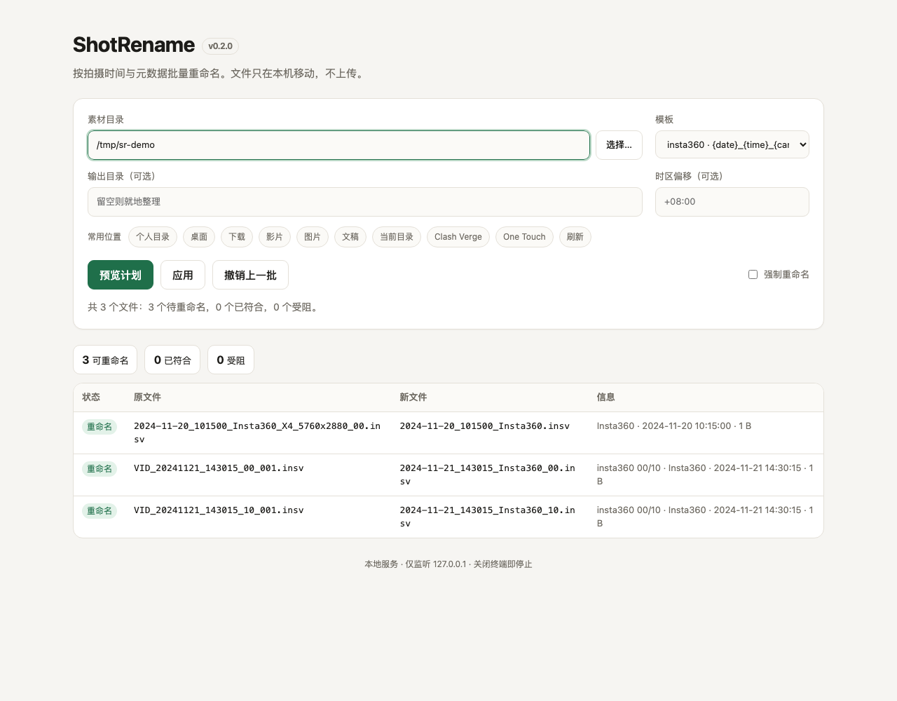

# ShotRename

**Batch rename videos by what's inside them.** Local-first, open source.

> Your camera names files `DJI_0001.MP4`. ShotRename names them by date, camera, GPS and resolution.

ShotRename reads what the file already knows: capture time, camera, lens, GPS, duration, resolution, frame rate, plus sidecar files. It then proposes a clean, consistent name. Content-aware titles are planned as an optional local model; nothing is uploaded.

ShotRename is an open-source alternative to closed-source video renamers such as RenamerX.

## Status

v0.2 works end to end, CLI and local web UI:

- scan `DJI_*`, `VID_*.insv`, `GX*`/`GP*`/`GOPR*` and generic footage;
- read MP4/MOV atoms, DJI SRT telemetry, FFprobe and ExifTool when installed;
- name Insta360 dual-lens `.insv` pairs as one shot, with `.LRV` proxies following each lens;
- name GoPro chapter groups (`GOPR` + `GP01` + `GP02`, or `GX01` + `GX02`) with `_ch01`, `_ch02`;
- resolve GPS to a city name offline, no API key;
- watch a folder and rename files once they stop growing;
- preview, apply, undo in a local web UI;
- render TOML templates and preview a plan without touching files;
- conflict suffixes, case-insensitive collision checks and an undo journal.

Still open: native desktop shell, optional local AI titles.

## Install

```bash
git clone https://github.com/banboat/shotrename
cd shotrename
cargo build --release
./target/release/shotrename --help
```

FFprobe and ExifTool are optional. Basic naming works with native MP4 atom parsing and DJI SRT files.

## Usage

```bash
# 1. Inspect what ShotRename can read
shotrename scan ./footage --tz +08:00

# 2. Build a plan (never writes to disk)
shotrename plan ./footage --template dji --tz +08:00 --out plan.json

# 3. Apply, with a journal for undo
shotrename apply plan.json --journal .shotrename/journal.jsonl

# 4. Undo the last batch
shotrename undo --journal .shotrename/journal.jsonl
```

Example plan:

```text
footage/DCIM/100MEDIA/DJI_0001.MP4
  -> footage/2024/11/2024-11-21_143015_DJI_Osmo_Action_5_Hangzhou_3840x2160.MP4
  + footage/DCIM/100MEDIA/DJI_0001.SRT -> footage/2024/11/2024-11-21_143015_DJI_Osmo_Action_5_Hangzhou_3840x2160.SRT
```

`plan` is idempotent: files already named by the template are marked `unchanged` instead of being renamed twice. Pass `--force` to rename them anyway.

### Insta360 and GoPro groups

A 360 shot is two `.insv` files, one per lens. ShotRename renders the name once and appends the lens token:

```text
VID_20241121_143015_00_001.insv  ->  2024-11-21_143015_Insta360_X4_5760x2880_00.insv
VID_20241121_143015_10_001.insv  ->  2024-11-21_143015_Insta360_X4_5760x2880_10.insv
LRV_20241121_143015_00_001.lrv   ->  2024-11-21_143015_Insta360_X4_5760x2880_00.lrv
```

GoPro chapters share one base name and keep their chapter number:

```text
GX010123.MP4 -> 2024-11-21_143015_GoPro_HERO12_3840x2160_ch01.mp4
GX020123.MP4 -> 2024-11-21_143015_GoPro_HERO12_3840x2160_ch02.mp4
```

### Watch a folder

```bash
shotrename watch ~/Movies/ingest --template dji --settle 3
```

Files land in the watched folder, for example from an SD card copy, and are renamed after they stay the same size for `--settle` seconds. Existing files are processed first; add `--no-initial` to only handle new arrivals.

Keep `--settle` long enough for the copy to finish: sidecars that arrive after their video was already renamed are left untouched.

### Local web UI

```bash
shotrename ui
```

Opens `http://127.0.0.1:<port>/` with a one-time token. Preview the plan, apply, or undo the last batch. The server binds loopback only and never uploads anything.

The footage field accepts a typed path, the `Choose…` button opens the system folder picker, or you can click a detected location. Mounted volumes are listed automatically; a card with a `DCIM` folder is tagged `SD`. Use `Refresh` after inserting a card.



## Templates

Templates are TOML, so they can live in Git and be reviewed like code:

```toml
name = "dji-default"
filename = "{date}_{time}_{camera}_{location}_{resolution}"
directory = "{date:%Y}/{date:%m}"
related = "strict"

[format]
date = "%Y-%m-%d"
time = "%H%M%S"
separator = "_"
sanitize = "unicode"
```

Fields: `date`, `time`, `camera`, `lens`, `location`, `location_zh`, `country`, `gps`, `resolution`, `fps`, `duration`, `codec`, `original`, `family`, `width`, `height`, `altitude`, `seq`.

`{date:%Y}` uses chrono's strftime syntax. Empty fields collapse together with their separators.

Built-in templates: `dji`, `insta360`, `gopro`. List them with `shotrename templates`.

Location names come from an embedded GeoNames city table (34k places, 150 km radius), so GPS resolves offline. `{location}` uses the primary name (`Hangzhou`); `{location_zh}` prefers the Chinese name (`杭州`).

## Design principles

1. Local-first. Footage does not leave the machine.
2. Deterministic by default. Metadata first; AI is optional.
3. Preview before apply. No silent overwrites.
4. Undo everything. Every apply writes a journal.
5. Templates as data. TOML files that can live in Git.
6. Sidecars travel with their video. `.LRF`, `.LRV`, `.SRT`, `.WAV`, `.THM`, including language-tagged subtitles.
7. Groups stay together. Dual-lens shots and chaptered recordings get one base name.

## Roadmap

- [x] CLI: scan, plan, apply, undo
- [x] MP4 atoms, DJI SRT, FFprobe/ExifTool adapters
- [x] Sidecar files and conflict suffixes
- [x] Insta360 dual-lens pairing (`.insv` `_00_` + `_10_`)
- [x] GoPro chapter groups (`GOPR`/`GP`/`GX`)
- [x] Offline location names from GPS
- [x] Watch folders with configurable settle time
- [x] Local web UI
- [ ] Native desktop shell (Tauri)
- [ ] Optional local AI titles

## Development

```bash
cargo test          # naming, sanitising, conflicts, MP4/SRT parsing, grouping, places
cargo build
```

Workspace layout:

```text
crates/core   templates, rendering, sanitising, conflict allocation, journal
crates/meta   filename detection, MP4 atoms, DJI SRT, FFprobe, ExifTool, groups, places
crates/cli    clap commands, planning, apply, watch, local UI
templates/    built-in TOML templates
assets/       embedded GeoNames city table (CC BY 4.0)
tools/        reproducible data build scripts
```

## License

Code: MIT. See [LICENSE](LICENSE).

Location data: GeoNames `cities15000`, CC BY 4.0. See [assets/README.md](assets/README.md).

## Not affiliated

ShotRename is an independent open-source project. It is not affiliated with RenamerX, Rename X, or any other product.

---

## 中文

**按视频内容批量重命名，本地优先，开源。**

v0.2 已能跑通命令行的完整链路，并带一个本地网页界面：

- 影石双镜头 `.insv` 成组改名，`LRV_` 代理文件跟着各自镜头走；
- GoPro 章节组 `GOPR`/`GP01`/`GX01` 共用主名，追加 `_ch01`、`_ch02`；
- GPS 离线反查城市名，内置 34k 城市表，不需要 API；
- `shotrename watch` 监控目录，文件大小稳定后自动改名；
- `shotrename ui` 打开本地网页，预览、应用、撤销；素材目录可手输、点「选择…」调系统文件夹选择框，或直接点检测到的磁盘，带 `DCIM` 的 SD 卡会标记出来；
- 重复规划幂等，已符合模板的文件标记为 `unchanged`；`--force` 可强制重命名。

已支持 `.LRF`、`.LRV`、`.SRT`、`.WAV`、`.THM` 跟随主视频，包含 `DJI_0001.en.srt` 这类语言后缀。

尚未完成：原生桌面外壳（Tauri）、可选的本地 AI 标题。
